
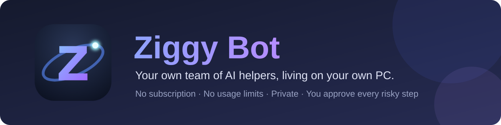

  
  
  

  <a href="#what-is-ziggy-bot"><b>What it is</b></a> &nbsp;·&nbsp;
  <a href="#features"><b>Features</b></a> &nbsp;·&nbsp;
  <a href="#talking-to-bots-in-a-group"><b>Group chats</b></a> &nbsp;·&nbsp;
  <a href="#part-1-getting-started"><b>Get started</b></a> &nbsp;·&nbsp;
  <a href="#part-2-for-advanced-users"><b>Advanced</b></a> &nbsp;·&nbsp;
  <a href="#questions-people-ask"><b>FAQ</b></a> &nbsp;·&nbsp;
  <a href="#feedback-and-support"><b>Feedback</b></a>

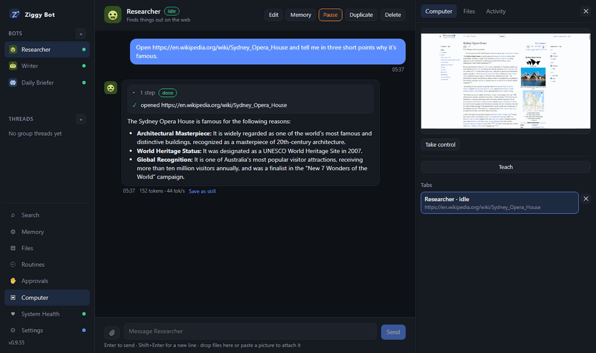

Real, not a mock-up: the app, its AI model and the web page, recorded as they happened.

<table align="center">
<tr>
<td align="center" width="33%"><b>1. Download</b> Get the installer from the <a href="https://github.com/Zygpolski/ziggybot-releases/releases/latest">latest release</a> and run it.</td>
<td align="center" width="33%"><b>2. Set up</b> Ziggy Bot checks your PC and fetches the AI model that fits your graphics card.</td>
<td align="center" width="33%"><b>3. Ask</b> Pick a ready-made bot and tell it what you need. That's it.</td>
</tr>
</table>

## What is Ziggy Bot?

Ziggy Bot is a Windows app that gives you **a team of AI helpers that work on your own PC**. Each bot has one job,
like *research this for me*, *write my morning briefing* or *keep an eye on this web page*. You talk to them like
colleagues. They browse the web, read and write files, do exact sums, remember what you tell them, work together as
a team and run jobs on a timetable, and they **always stop to ask you** before doing anything that can't be undone.

The AI runs on your own graphics card: **no subscription, no usage limits, and your data stays on your computer.**
Ziggy Bot is in active development, with improvements arriving through its built-in updates.

> [!IMPORTANT]
> **Ziggy Bot is in beta.** It works, and it's used every day, but it's young software: you may meet the odd bug or
> rough edge, and things will keep improving through its updates. **Beta testers are very welcome.** If you need help,
> something doesn't work, or you have an idea, email **[zygpolski@proton.me](mailto:zygpolski@proton.me)** or use the
> [bug report form](https://github.com/Zygpolski/ziggybot-releases/issues/new/choose). Every message is read.

> ⭐ **Like the idea?** Star this page: it's how other people find Ziggy Bot, and it helps more than you'd think.

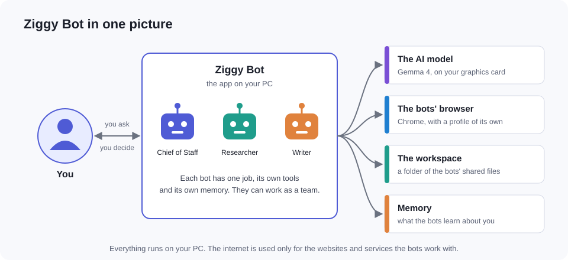

## Features

<table>
<tr>
<td width="33%" valign="top"><b>🤖 Bots with one job each</b> Start from a ready-made template or from scratch. Each bot has its own name, face, instructions, tools and memory.</td>
<td width="33%" valign="top"><b>💬 Chat like a colleague</b> Message a bot, attach files and pictures (it can see them), and watch every step it takes.</td>
<td width="33%" valign="top"><b>👥 Teams</b> Put several bots in one thread. The lead splits your request, hands out the parts and reports back.</td>
</tr>
<tr>
<td valign="top"><b>🌐 Its own web browser</b> Bots search, open pages, click, type and read, tables and charts included, in a Chrome of their own.</td>
<td valign="top"><b>🔑 You do the human bits</b> Sign-ins, "are you human" checks and codes come to you: the browser takes turns between you and the bots.</td>
<td valign="top"><b>✅ Approvals</b> Sending, buying, posting, deleting, your personal details: nothing happens until you press Approve.</td>
</tr>
<tr>
<td valign="top"><b>🧠 Memory</b> Bots remember what you tell them, show you what they learnt, and forget it when you delete it.</td>
<td valign="top"><b>📚 Skills</b> Save a method that worked, or show a bot how by doing it yourself while it watches.</td>
<td valign="top"><b>⏰ Routines</b> Jobs that run by themselves: every morning, every 15 minutes, once, or "watch until this happens".</td>
</tr>
<tr>
<td valign="top"><b>🧮 Exact maths</b> A calculator tool, so figures are worked out, never guessed.</td>
<td valign="top"><b>📁 Files and a terminal</b> A shared workspace folder, and a Windows terminal that asks before anything risky.</td>
<td valign="top"><b>🔌 Connectors</b> Plug in other services and APIs, with their keys stored encrypted.</td>
</tr>
<tr>
<td valign="top"><b>🔍 Search</b> Find any message in any chat in seconds.</td>
<td valign="top"><b>🔄 Updates</b> The app and its AI model update themselves when you press Update.</td>
<td valign="top"><b>💻 Fits your PC</b> Set up picks the size of AI model that suits your graphics card.</td>
</tr>
</table>

## Why Ziggy Bot?

AI assistants that *do* things, not just chat, arrived as cloud services, Grok Bot among them: a team of named bots
that browse, remember, run routines and hand work to each other. A brilliant idea, but one that lives on someone
else's servers, with a monthly fee, limits on how much you can use it, and your conversations in another company's
cloud. Ziggy Bot asks a simple question: **what if that whole team lived on your own PC instead?**

| | Ziggy Bot | A typical cloud AI assistant |
|---|---|---|
| **Cost** | Free to use: the AI runs on your own graphics card | A monthly subscription |
| **Limits** | None: use it as much as you like | Message caps and usage tiers |
| **Your data** | Chats, memories, files and sign-ins stay on your PC | Stored on the company's servers |
| **Your bots** | As many as you like, each with its own job, tools and memory | What the service offers |
| **The AI model** | A standard one, or an uncensored one you choose | The company's choice |
| **Risky actions** | Nothing that can't be undone happens without your OK | Depends on the service |
| **Works offline** | Yes, for your own files (the web needs the internet, of course) | No |

## Why Gemma 4?

  
  
  

Picking the brain behind your bots wasn't a guess. Before Gemma 4 earned its place, I tested at least 10 different
local AI models, which were all put through exactly the same tough tests, side by side. Gemma 4 pulled ahead where it
matters most for a team of helpers that works all day.

| 🧪 The test | Another local model tested | 🏆 Gemma 4 |
|---|---|---|
| 🗓️ **A long day:** a chat with 28 hours of history | 37 of 40. Three times it answered *without opening the page* | **40 of 40** |
| 🚦 **Behaving under pressure** | An emoji flood, remembered words leaking into replies, a command run outside the workspace without asking | **None of that** |
| ✅ **Every scenario**, after Ziggy Bot's safety work | — | **192 of 192 (100%)** |

The other model kept making mistakes; Gemma 4 got every answer of its own right. That settled it.

<table>
<tr>
<td width="33%" valign="top"><b>🔧 Made for tools</b> It reliably opens pages, clicks, saves files and does sums when asked, instead of just talking about it.</td>
<td width="33%" valign="top"><b>👀 It can see</b> It reads the pictures you attach and the web pages your bots open, tables and charts included.</td>
<td width="33%" valign="top"><b>📏 One family, every card</b> Sizes from 6 GB to 32 GB graphics cards: the same behaviour, scaled to your PC.</td>
</tr>
<tr>
<td valign="top"><b>🧘 Steady over a long day</b> No floods, no rambling, no "remembering" things you never said.</td>
<td valign="top"><b>🔓 Open and yours</b> An open model under the Apache 2.0 licence, running entirely on your PC.</td>
<td valign="top"><b>🎓 Room to grow</b> Its uncensored version, for studying cyber security, scored 167 of 168 on the same scorecard, against Gemma 4's own 168 of 168.</td>
</tr>
</table>

## Talking to bots in a group

Put several bots in one **group thread** and talk to the whole team at once. Use **@** to choose who answers:

| You type | What happens |
|---|---|
| `Plan a weekend in the Blue Mountains` | No bot named, so the group's **lead** takes it, hands parts to the others and reports back |
| `@Researcher find three facts about the Blue Mountains` | Only the **Researcher** answers |
| `@Writer give me a fun title for the trip` | Only the **Writer** answers |

Type **@** and a list of the group's bots pops up: pick one with the arrow keys and Enter. See
[Teams of bots](#6-teams-of-bots) for more.

## How this guide works

| If you are... | Start here |
|---|---|
| **New to Ziggy Bot** | [Part 1: Getting started](#part-1-getting-started): install it, make your first bot and chat, step by step |
| **Ready for more** | [Part 2: For advanced users](#part-2-for-advanced-users): every tool, setting and safety rule |
| **Looking for a quick answer** | [Questions people ask](#questions-people-ask) and the [glossary](#glossary) |
| **Stuck, or found a bug** | [Feedback and support](#feedback-and-support) |

---
# Part 1: Getting started

## 1. What you need

| | |
|---|---|
| **Windows** | Windows 11, 64-bit |
| **Graphics card** | An NVIDIA card with at least 6 GB of memory, and an up-to-date driver |
| **Disk space** | 6 to 22 GB free, depending on your graphics card (see below) |
| **Google Chrome** | Installed as normal. The bots get their own separate Chrome profile; yours is never touched |
| **Internet** | Once, to download the AI model, and then for whatever websites your bots visit |

**Ziggy Bot picks the AI model for your graphics card by itself.** The AI model is Gemma 4, which comes in several
sizes. A bigger card runs a bigger, cleverer version; a smaller card runs a smaller one. Set up reads your card and
downloads only the version that fits:

| Your card's memory | For example | The version you get | Download |
|---|---|---|---|
| 6 GB | RTX 2060, 3050, 4050 | Gemma 4 E2B | 4.1 GB |
| 8 GB | RTX 3060 Ti, 3070, 4060 | Gemma 4 E4B | 6.0 GB |
| 12 GB | RTX 3060 12 GB, 4070 | Gemma 4 12B | 7.3 GB |
| 16 GB | RTX 4060 Ti 16 GB, 4080, 5080 | Gemma 4 12B, kept more exactly | 10.0 GB |
| 24 GB | RTX 3090, 4090 | Gemma 4 26B | 15.4 GB |
| 32 GB | RTX 5090 | Gemma 4 31B | 18.5 GB |

The smaller versions make more mistakes when they use tools, so bots on a 6 or 8 GB card work best with simple,
clearly worded jobs.

> **Tested so far:** the 12 GB version, which Ziggy Bot was built and tested on. The other versions are **not tested
> yet**: their memory use is an estimate, and on a 6 GB card the model may not fit beside what Windows already uses.

## 2. Install it and start it

1. Download `ZIGGYBOT-Setup-<version>.exe` from the [releases page](https://github.com/Zygpolski/ziggybot-releases/releases/latest)
   and run it. Pick any folder.
2. Start **Ziggy Bot** from the Start menu or the desktop shortcut.
3. The first time, Ziggy Bot opens its **Set up** page. It checks your PC, says which version of the AI model your
   card gets, lists what it will download and how big each file is, and waits for you to press **Set up**.
4. It downloads everything from the official sources. Every file is checked against its published fingerprint
   before it's used, so a damaged or tampered file is never loaded. If the download is interrupted, press Set up
   again and it carries on where it stopped.

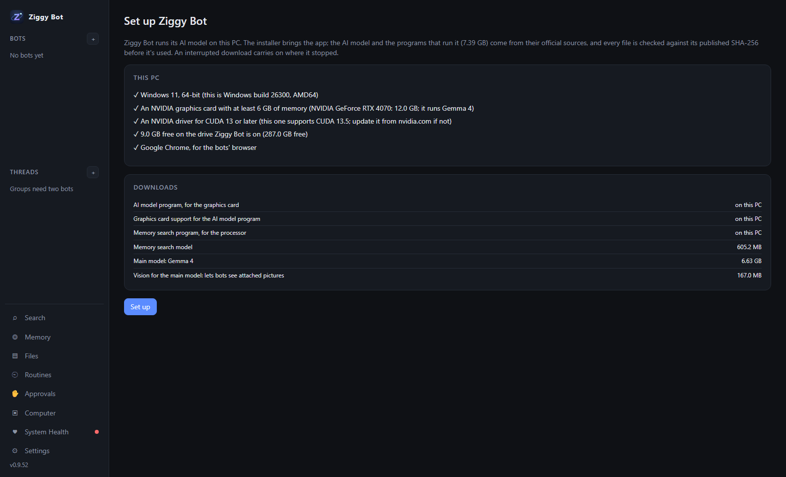

When it's finished, the model starts by itself (a few seconds) and you're ready.

Windows may warn that the publisher is unknown the first time you run the installer; choose **More info → Run
anyway**.

**Updates** arrive by themselves: when there's a new version, Ziggy Bot says *Update available* and installs it when
you press **Update**. Your bots, chats, memories and settings are kept.

## 3. A tour of the window

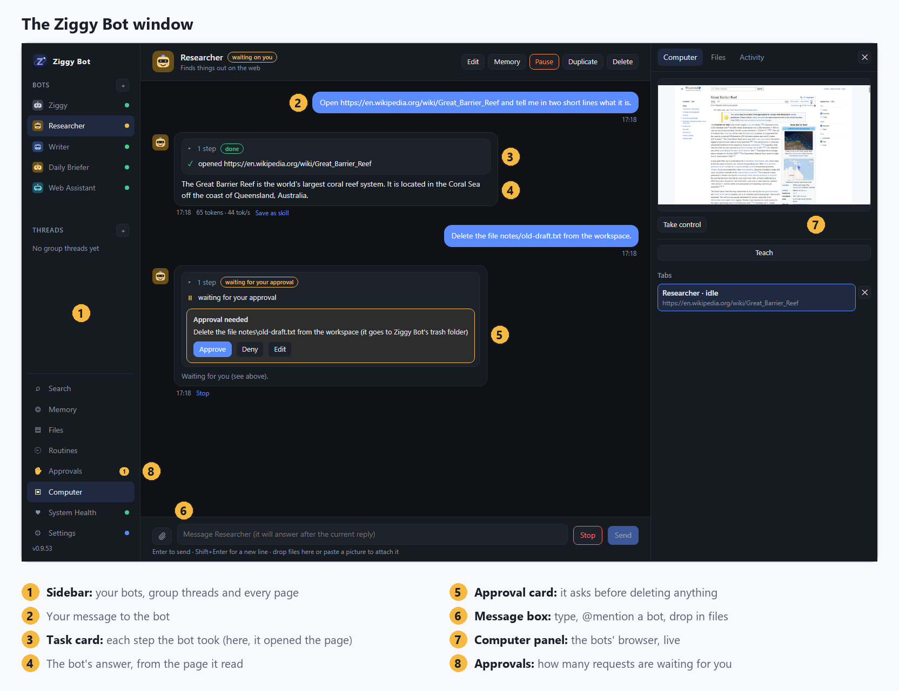

- **The sidebar** (left) lists your **Bots** and your **Threads** (team chats), then the pages: Search, Memory,
  Files, Routines, Approvals (with a red count when something is waiting for you), Computer, System Health and
  Settings. Right-click a bot or a thread for more: rename, edit, pause, duplicate, delete chat, move to trash.
- **The conversation** (middle) is where you chat. Your messages are on the right, the bot's on the left.
- **The Computer panel** (right) shows the bots' web browser live, which tab belongs to which bot, and a log of
  everything they did.

Ziggy Bot also has an icon in the Windows tray (by the clock) with **Open**, **Pause all bots** and **Quit**.
Closing the window keeps it running in the tray, so routines carry on.

## 4. Make your first bot

1. Press **+** next to **Bots** in the sidebar.
2. Pick a **template**, or **Blank** to start from nothing. Each template is a ready-made bot with the tools its job
   needs and no more. Among them:

   | Template | What it does |
   |---|---|
   | **Chief of Staff** | Runs a team: splits your request between other bots and reports back. Can make new bots and team threads (with your OK) |
   | **Researcher** | Finds things out on the web and in files; has every everyday tool |
   | **Market Watcher** | Follows the stocks you care about: live prices, the day's move and the year's range |
   | **Market Analyst** | Explains markets and trading in plain words: trends, key levels, risks and the sums |
   | **Trend Scout** | Spots what's trending |
   | **Daily Briefer** | Writes you a short briefing, ideal as a daily routine |
   | **Web Assistant** | Does things on websites for you: clicks, types, reads |
   | **Data Collector** | Gathers figures from pages into files |
   | **Writer** | Drafts and edits text and files |
   | **Security Tutor** | Teaches cyber security with legal practice labs |

   None of them sends, buys or posts anything on its own.
3. Change its name, picture, job or instructions if you like, and save. It appears in the sidebar with its own chat.

**The bot editor** (the **Edit** button at the top of a bot's chat) has everything about a bot: **Instructions**,
**Tools & Connectors** (tick what it may use), **Skills**, **Routines**, **Memory** and **Permissions**.

## 5. Chat with a bot

Type in the message box and press Enter. While the bot works you'll see a **task card** above its reply; open it to
see every step: which page it opened, what it read, what it worked out.

- **Attach files** with the attach button, or drag them onto the chat. Pictures are shown to the AI, so you can ask
  "what's in this screenshot?".
- **Stop** (beside the message box) stops the bots working in that chat.
- **Right-click a message** for **Remember this**, to save it as a memory word for word.
- **Search** in the sidebar finds any message in any chat.

A bot's status dot in the sidebar shows what it's doing: idle, working, waiting on you, paused, or an error.

Tips for good answers:

- **One job per bot.** A focused bot does better than one that does everything.
- **Say what you want back**: "the opening hours and the address", "a list of five", "save it as trip-notes.md".
- **Bots save files only when you ask** ("save", "file", "export"). Otherwise they answer in the chat.
- **Figures are worked out with the calculator** for bots that have it, so sums are exact.

## 6. Teams of bots

A **thread** is a group chat with several bots. Press **+** next to **Threads**, give it a name and pick its bots.

- A message that doesn't name a bot goes to the thread's **lead**: the Chief of Staff if it's there, otherwise the
  first bot you added (you can change it).
- Type **@** and a bot's name to speak to one bot directly.
- The lead can **hand work to the other bots** in the thread. You'll see "I've asked …", then each bot's part, then
  the lead's report.
- So bots can't chat among themselves forever, a thread pauses after 12 turns between bots without you (you can
  change the number, or switch the limit off, in Settings).

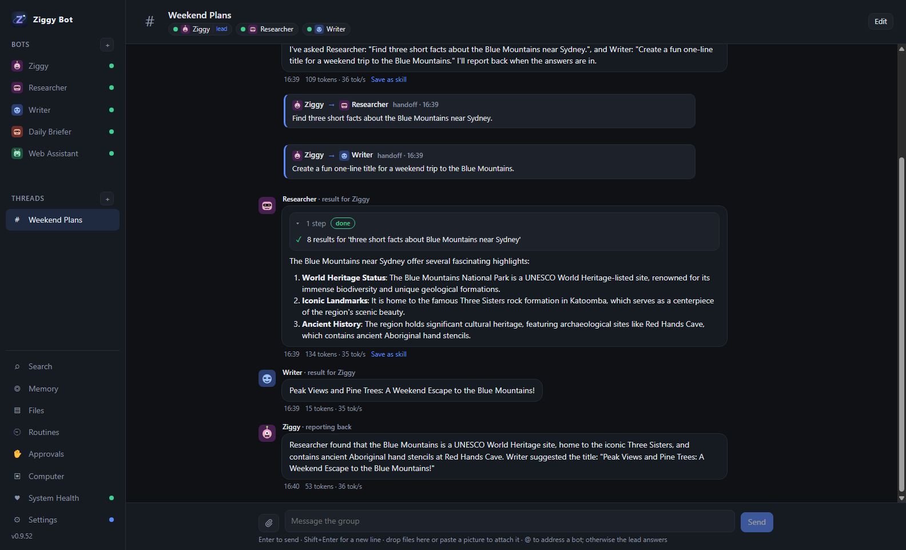

## 7. The bots' browser, and taking turns

Your bots have **their own Chrome**: the Chrome you already have, but with a separate profile used only by the bots.
Your own Chrome, your passwords and your everyday profile are never opened.

**When a bot opens a page for you, its browser comes up in front of you**, so you can watch it work, and the
**Computer panel** opens beside the chat. **Minimise** the browser and it tucks into that panel, where you can keep
an eye on it; **close it with ✕** when you're done. Web searches and routines run out of sight, and you can watch
them in the Computer panel too. Websites can tell the bots' browser is automated, and Ziggy Bot doesn't hide that.

Some things only a person should do: **signing in, "are you human" checks, two-step codes, installing an extension**
(a password manager, say). For those, the browser **takes turns**:

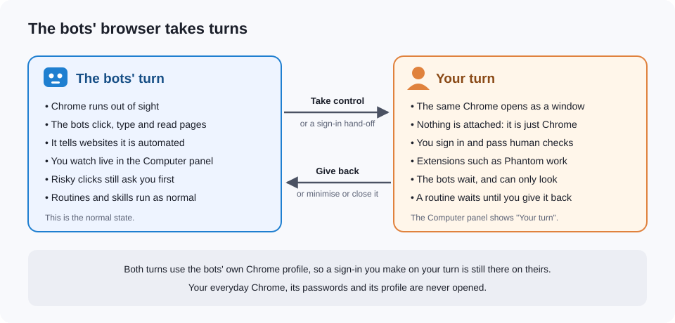

- **Your turn** starts when you press **Take control** in the Computer panel, or when a bot reaches a sign-in or a
  check and hands it to you (you get a notification). The same Chrome opens as an ordinary window, so websites see a
  normal browser. Sign in, tick the box, install the extension: whatever is needed. The panel shows **Your turn**.
- **Give it back** with **Give back** in the panel, or by minimising or closing that window. Ziggy Bot lets Chrome
  finish saving first, so anything you signed in to stays signed in and an extension you added stays added. If Chrome
  is still busy (a download, say), it stays your turn and Ziggy Bot tells you why. The bots' Chrome comes back,
  out of sight, with the same tabs.
- **During your turn the bots wait.** If you ask a bot about the page then, it can only *look* at your screen; it
  won't click or type. Routines that need the browser wait too, and the panel shows how many are waiting, so you
  don't forget to give it back.

**Bots never sign in for you.** Sign-ins, passwords and codes are always yours. A few websites refuse automated
browsers even after you've signed in; then the bot says so, and that job is one to do yourself.

## 8. Approvals: nothing risky without your OK

Before a bot does something that can't be undone, it stops and asks. An **approval card** appears in the chat
saying exactly what will happen, with **Approve**, **Deny** and **Edit** (change the details first, then approve).
Waiting approvals also collect on the **Approvals** page, with a count in the sidebar and a Windows notification.

It asks before, for example: sending or posting anything, buying or paying, submitting a form with personal
details, deleting files, clicking a button that submits something, running an unknown terminal command, and making
new bots or threads.

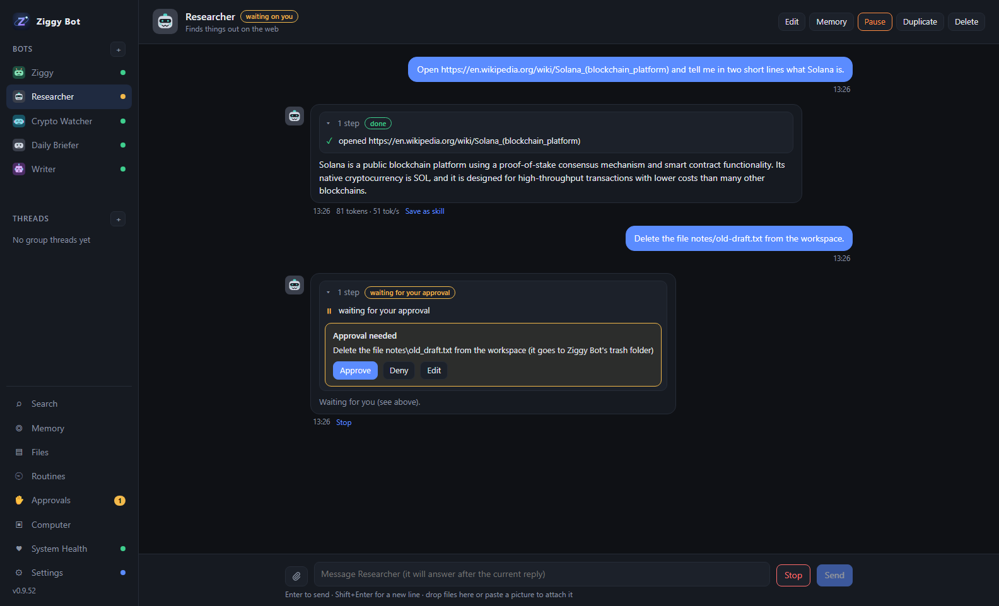

## 9. Memory

Bots remember what you tell them. When a reply has taught a bot something new, a **Memory updated** chip appears
under it; press **Undo** if it got something wrong.

- Memories are saved **from your words** (and what the bot's tools found), never from the bot's own reply, so a bot
  can't "remember" something it made up.
- The **Memory** page shows them all: search, add, edit, pin or delete. Delete one and the bots forget it, including
  where you said it.
- For things that change (the weather, opening hours, the news), bots check the live source instead of trusting memory.

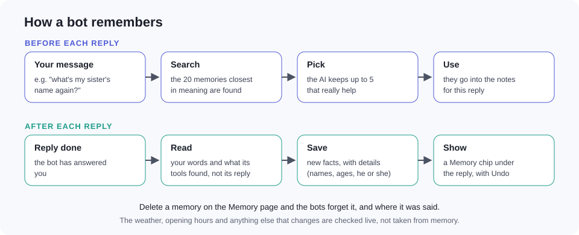

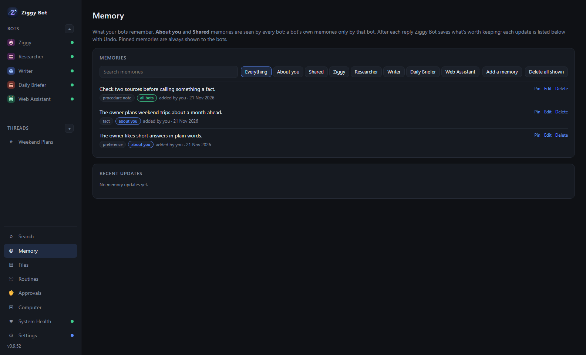

## 10. Skills: teach a bot how

A **skill** is a saved method: "to plan a day out, check the weather for that date, find the opening hours, sum it up…". When a
request matches a skill, the bot follows it. Three ways to make one:

- **Save as skill**, under a reply that went well.
- **Teach**: do the task yourself in the bots' browser while the bot watches; Ziggy Bot turns what you did into a
  skill for you to check and save.
- **Write one** in the bot editor's **Skills** section.

A good path is: **ask once → save it as a skill → make it a routine.**

## 11. Routines: jobs on a timetable

The **Routines** page runs a bot's job by itself. Press **New routine**, pick the bot, say what it should do (or pick
a skill) and when:

- **On a schedule**: every day at 9:00, weekdays, one day a week, every hour…
- **Every…**: every 15 minutes, every 2 hours…
- **Once**: at a date and time.
- **Watch**: check again and again until something happens (a page announces new tickets, say), then tell you and stop.

The bot's report appears in its chat. **A run that finds nothing new stays quiet**, so you're only told when there's
news. Every run is in the routine's history, and **Run now** tries one straight away.

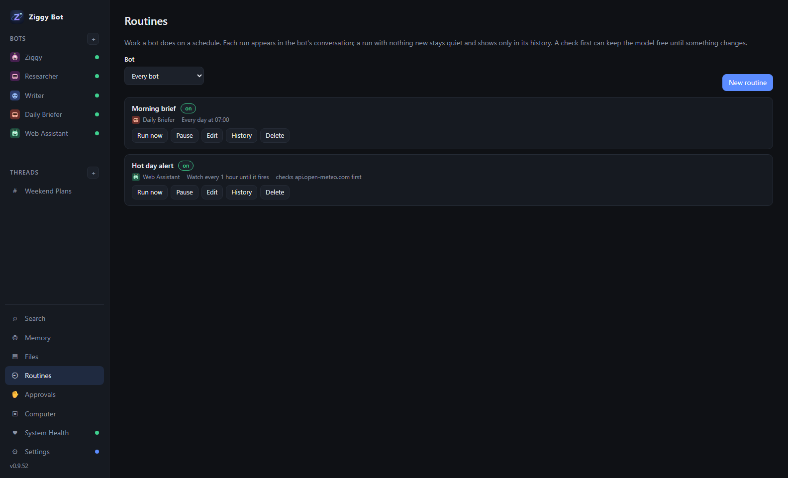

## 12. Good to know

- **Ziggy Bot works while your PC is on and awake.** While a bot works, it keeps the PC from going to sleep (the
  screen can still turn off).
- **There's one AI model, and bots take turns using it.** You always go first. Two bots can write at once; more
  wait a moment.
- **Games and other graphics-heavy programs slow the bots down**, because they share the graphics card. **Pause all
  bots** (in the tray or Settings) gives the card back to you.
- **It's a smaller model than the big cloud AIs.** It's good at focused jobs and weaker at long, open-ended ones,
  which is why bots each have one job, and why skills and the calculator exist.

---

# Part 2: For advanced users

## 13. Every tool a bot can have

Tick tools for a bot in its editor (**Tools & Connectors**). A bot is only ever shown the tools you gave it.

| Group | Tool | What it does | Asks first? |
|---|---|---|---|
| Web | `web_search` | Searches the web and returns titles, addresses and snippets | No |
| Web | `fetch_url` | Reads a page or an API quickly, without the browser | No |
| Web | `save_file` | Saves results (text, CSV, JSON) into the workspace | No (an old version goes to the trash) |
| Browser | `open_page` | Opens an address in the bot's browser tab and looks at it | No |
| Browser | `click` | Clicks a numbered button or link on the page | If it submits or might be risky |
| Browser | `type_text` | Types into a box on the page | No (never into password boxes) |
| Browser | `page_action` | Scrolls, goes back or forward, reloads | No |
| Browser | `read_page` | Reads the whole page, in parts if it's long | No |
| Browser | `extract` | Pulls set facts out of a page as a table of fields | No |
| Files | `list_files` | Lists what's in the workspace | No |
| Files | `read_file` | Reads a text file from the workspace | No |
| Files | `write_file` | Creates or changes a text file | No (an old version goes to the trash) |
| Files | `delete_file` | Deletes a file or folder (to Ziggy Bot's trash) | Yes |
| Terminal | `run_command` | Runs a Windows command in the workspace | Unless it's read-only and stays in the workspace |
| Maths | `calculate` | Works out sums exactly | No |
| Ziggy Bot | `create_bot` | Makes a new bot, with its tools | Yes |
| Ziggy Bot | `create_thread` | Makes a team thread from existing bots | Yes |

## 14. Approval settings: auto, ask, never

Every tool that can ask has a setting, in **Settings → Approvals** for all bots, or in a bot's **Permissions** for
that bot alone:

- **ask** (the default for anything risky): an approval card every time.
- **auto**: it runs without asking. Use it only for a bot and a tool you fully trust.
- **never**: refused every time; the bot's reply says so.

The Approvals page keeps a history of every decision, which you can clear.

## 15. Connectors and APIs

A **connector** plugs another service into Ziggy Bot so bots can use it as tools. Ziggy Bot speaks MCP, the common
standard for AI tool servers: add one in **Settings → Connectors & APIs**, either a program on your PC or a web
address.

- **Keys and passwords** go in *secret* fields. They're stored encrypted with Windows' own protection and never
  shown again, never given to the AI, never written to logs and never included when you export a bot.
- **Each connector is switched on per bot**, in the bot's editor.
- A connector tool that only reads runs without asking; anything else asks first, and each one has its own
  auto / ask / never setting.
- **A public API needs no connector at all**: a bot with `fetch_url` can read it directly. An API that needs a key
  goes through a connector, so the key stays secret.

## 16. The terminal

`run_command` runs Windows PowerShell commands with the workspace folder as its starting point. Commands that only
read, and stay inside the workspace, run straight away; anything that touches other folders, settings or the
registry asks first. Ziggy Bot's own passwords are never visible to it.

## 17. Routines in depth

A routine has a name, a bot, what to do (a request, or a skill with its details), a schedule and these extras:

- **Check first**: a plain check that runs *without* waking the AI, so the graphics card stays free. Watch **a web
  page** (fires when it changes, contains some text, or no longer contains it) or **a value from an API address**
  (fires when it changes, is above or below a number, or equals something, e.g. `current.temperature`). The bot is only
  woken when the check fires.
- **Nothing new when…**: describe what counts as no news; the bot then answers NOTHING NEW and the run stays quiet.
- **Retries if a run fails**, and how many minutes apart.
- **If the PC was off or asleep at its time**: run it once when the PC is back, or skip it.
- **Switched on** or off, and **Run now**.

Once and Watch routines switch themselves off after they fire. At start-up, Ziggy Bot can resume routines by itself
(Settings → Bots).

## 18. Teach in depth

Press **Teach** (on a bot's Skills section or the Computer panel), choose the bot, then do the task in the bots'
browser. Ziggy Bot records where you went, what you clicked and typed (password boxes are masked) and what each
thing on the page was. When you finish, it drafts a skill with the parts that change each time (a place name, a
date) turned into details you fill in. You review it, edit it and save it.

When the bot later uses the skill, it follows it as *instructions*, not as a blind replay, so small changes to the
page don't break it. On a site with a sign-in or a human check, sign in on your turn first, then Teach.

## 19. Templates: share and reuse bots

- **Export** a bot from its editor as a `.ziggybot.json` file: its instructions, tools, skills, routines and any
  memories you tick. Conversations, logins, connectors and secrets are never included.
- **Import** it from **New bot → Import a template file…**, on this PC or another. Imported routines arrive switched
  off, so nothing runs until you say so.
- **Duplicate** a bot from its right-click menu to try a variation.
- Bots you delete go to the trash for 30 days and can be restored; Settings can delete them for good.

## 20. Memory in depth

- **Three kinds:** memories **about you** (every bot sees them), **shared** ones (from team threads) and each
  **bot's own**.
- **Before each reply**, Ziggy Bot finds the 20 memories closest in meaning to your message, and the AI picks up to 5
  that really help. Memories that merely share a word aren't used.
- **Pin** a memory and every bot always sees it.
- **Remember this** (right-click a message) saves your words as they are, even a bot's words if you choose.
- **Deleting is for good**, one memory or every one shown, and the bots forget it.

## 21. The AI model

- **Which version:** picked for your graphics card at Set up (see [section 1](#1-what-you-need)). Settings → Main
  model shows it, verified against its published fingerprint, with a **Verify** button.
- **Gemma 4 Abliterated:** on 12 GB cards and up, Settings offers an uncensored version of Gemma 4 that refuses less.
  It's meant for studying cyber security; it guesses more often when it doesn't know, so check its facts.
- **Seeing pictures:** each version comes with its vision part, so bots can see the pictures you attach and the web
  pages they open.
- **Model updates:** once a week (or when you press **Check now**), Ziggy Bot looks for newer model files and model
  programs. Nothing changes until you press **Update**; each download is checked before it's used, and a version
  Ziggy Bot has tested is labelled **Tested**.

## 22. System Health

Every part of Ziggy Bot is listed with a green or red light, its last error and a **Restart** button. It also shows
real figures: the graphics card and its memory, the processor and memory, the model in use and its speed, how many
requests are waiting, how much disk Ziggy Bot uses, and how many words (tokens) each bot has used.

## 23. Settings in depth

| Section | What's in it |
|---|---|
| **Main model** | The model for your card, its vision part, verification, model updates |
| **Approvals** | auto / ask / never for each tool and connector tool |
| **Bots** | The team-thread turn limit (or none), resuming routines at start-up, the trash |
| **Connectors & APIs** | Add, edit and remove connectors; secret keys |
| **Backups** | A daily backup of your data (the last 14 kept), and an optional copy to another folder, such as a cloud drive |
| **Startup & tray** | Start with Windows, keep the PC awake while bots work, Pause all bots |
| **Notifications** | Windows notifications for approvals, hand-offs and routine results, each on or off |
| **Appearance** | Dark or light theme, and zoom (100, 125 or 150%) |
| **Data folders** | Where everything is kept |

## 24. What happens when you send a message

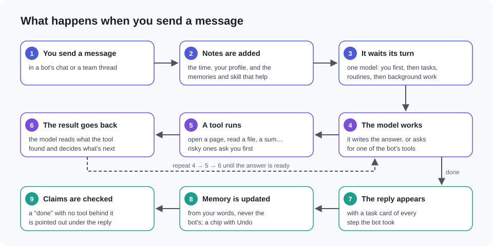

1. **You send a message.**
2. **Notes are added** for this reply: the time, a short profile of you, the memories that help and a matching skill.
3. **It waits its turn.** One graphics card means one AI model, shared by every bot. You go first, then tasks, then
   routines, then background work.
4. **The model works.** It writes the answer, or asks to use one of the bot's tools.
5. **The tool runs**, if it's allowed, with an approval card first if it's risky.
6. **The result goes back** to the model, which decides what to do next. Steps 4 to 6 repeat until the answer is
   ready, with limits, so a confused bot stops and says why instead of going round in circles.
7. **The reply appears**, with the task card of every step.
8. **Memory is updated** in the background.
9. **Claims are checked.** If the reply says the bot *did* something ("I've saved it") and no tool did, Ziggy Bot
   says so under the reply.

## 25. Safety: you stay in charge

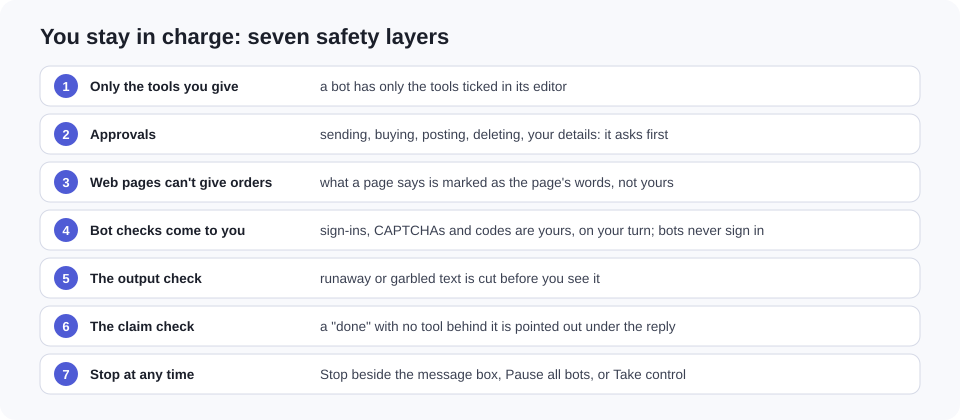

- **Only the tools you give.** A bot without the delete tool can't delete, however it's asked.
- **Approvals** for anything that can't be undone.
- **Web pages can't give orders.** What a page says is treated as the page's words, never yours, and anything
  irreversible still needs you.
- **Bot checks come to you**, and bots never sign in.
- **The output check** stops runaway or garbled text before it reaches you.
- **The claim check** points out a "done" with nothing behind it.
- **Stop**, **Pause all bots** and **Take control** are always there. A bot that gets stuck pauses with its progress
  kept, and offers **Resume** or **Retry**.

Everything stays on your PC. Ziggy Bot only accepts connections from your own computer, and its AI model only
answers Ziggy Bot.

## 26. Where your things are kept

Everything lives in Ziggy Bot's own folder, wherever you installed it:

| Folder | What's in it |
|---|---|
| `app\` | the program |
| `models\` | the AI model files |
| `data\` | your bots, chats, memories and settings, encrypted keys, the bots' browser profile, logs |
| `workspace\` | the bots' shared files |
| `backups\` | daily backups |
| `trash\` | deleted bots and files, kept 30 days |

Nothing is written anywhere else, so moving or removing Ziggy Bot is just that folder.

---

## Questions people ask

**Is it really free to use?** Yes. The AI runs on your own graphics card, so there's no subscription and no limit on
how much you use it. You pay only for your electricity.

**Does it need the internet?** Once, to download the AI model. After that, only for the websites and services your
bots visit. Chatting about your own files works offline.

**Is my data private?** Your chats, memories, files and sign-ins stay on your PC. Nothing is sent anywhere except the
websites and services your bots use for you.

**Can a bot spend my money or send messages on its own?** No. Sending, buying, posting, deleting and submitting your
details always wait for your Approve, unless you deliberately set a tool to auto.

**What if a website blocks it?** Press Take control, do the step yourself on your turn, and give it back. A few sites
refuse automated browsers entirely; the bot tells you when that happens.

**Can I use my browser extensions?** Yes: install them in the bots' browser on your turn. Their passwords
stay yours, and anything that sends, buys or signs waits for your approval.

**Will it slow my games down?** Bots share your graphics card, so heavy games and bots slow each other. Pause all
bots while you play.

**Is there a Mac or Linux version?** Not yet: Ziggy Bot is for Windows 11 with an NVIDIA graphics card.

**Windows says the publisher is unknown. Is that safe?** That's Windows being careful with a new app from an
independent maker. Download Ziggy Bot only from this page's [releases](https://github.com/Zygpolski/ziggybot-releases/releases/latest),
then choose **More info → Run anyway**.

---

## Feedback and support

Ziggy Bot is in beta and in active development: new features and fixes arrive regularly through its built-in updates. As a young
project it may still have the odd rough edge, and your feedback is the fastest way to smooth it out. Whether something
isn't working, something could be clearer, or you have an idea for a new feature, I'd love to hear from you.

  
  
  

Report a bug or suggest an idea with the buttons above (a short form on GitHub), or by email if you'd rather keep it
private.

**Reporting a bug.** The more of these you can include, the quicker it can be found and fixed:

- **Your version**, shown at the bottom of the sidebar (for example *v0.9.55*).
- **What you did**, step by step: which bot (and the template it came from), and what you asked it.
- **What you expected**, and **what happened instead**, word for word if there was an error.
- **Whether it happens every time**, or only now and then.
- **A screenshot**, if you can. Ziggy Bot's **System Health** page is useful too if something shows red there.

**Suggesting an idea.** Tell me what you'd like a bot to do for you, and why. Real examples of jobs you want done
help the most.

> **Please never send passwords, keys or other private details.** They're never needed for a bug report. If a
> screenshot shows something private, cover it before you send it.

Every report is read, and reports like yours decide what gets fixed and built next.

---
## Glossary

| Word | Meaning |
|---|---|
| **AI model** | The "brain" that reads and writes text and looks at pictures |
| **Approval** | A card asking your OK before a bot does something that can't be undone |
| **Bot** | A helper with one job, its own instructions, tools and memory |
| **CAPTCHA** | An "are you human" test on a website. Always done by you |
| **Connector** | A way to plug another service into Ziggy Bot so bots can use it as a tool |
| **Fingerprint (SHA-256)** | A code that identifies a file exactly; if one byte changes, the code changes |
| **Profile (Chrome)** | Chrome's folder of sign-ins, history and extensions. The bots have their own |
| **Routine** | A bot's job that runs by itself on a timetable |
| **Skill** | A saved method a bot follows for a kind of task |
| **Thread** | A group chat with several bots |
| **Token** | A piece of a word; AI models read and write in tokens, and they're how use is counted |
| **Tool** | Something a bot can do besides talk: open a page, read a file, do a sum… |
| **Workspace** | The folder where the bots keep their files |

---

## Copyright

Copyright © 2026 Zygpolski. All rights reserved. No licence is granted to copy, modify or share Ziggy Bot. The
software and AI models it uses that were made by others stay under their own licences. See [LICENSE](LICENSE).
